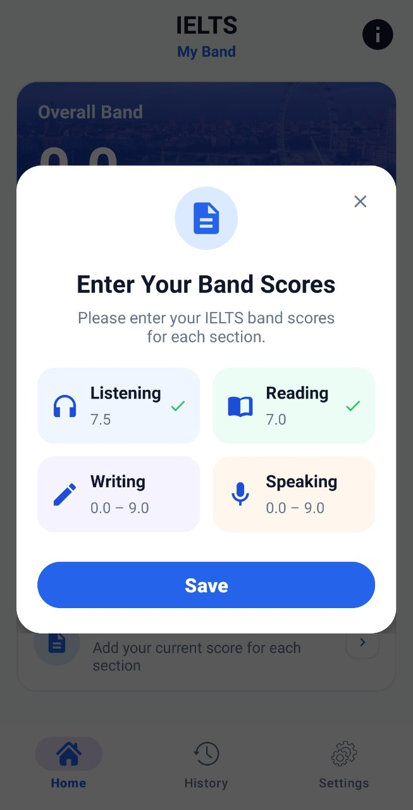
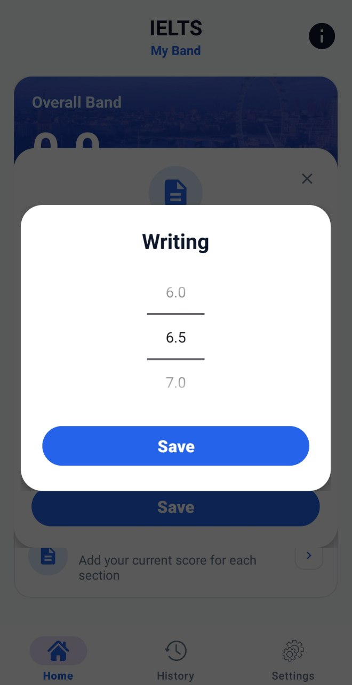
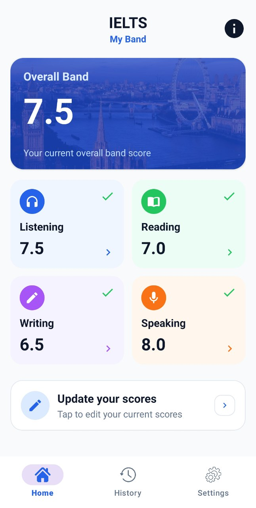
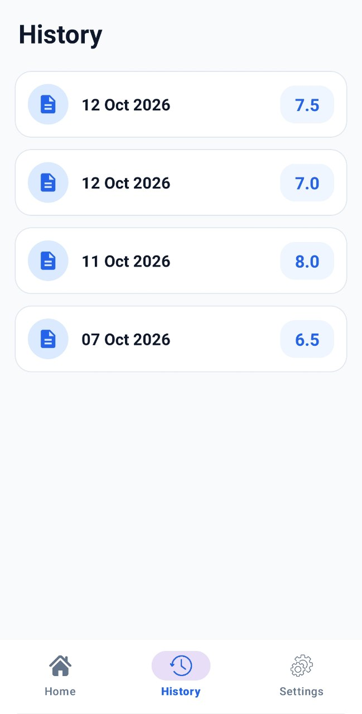
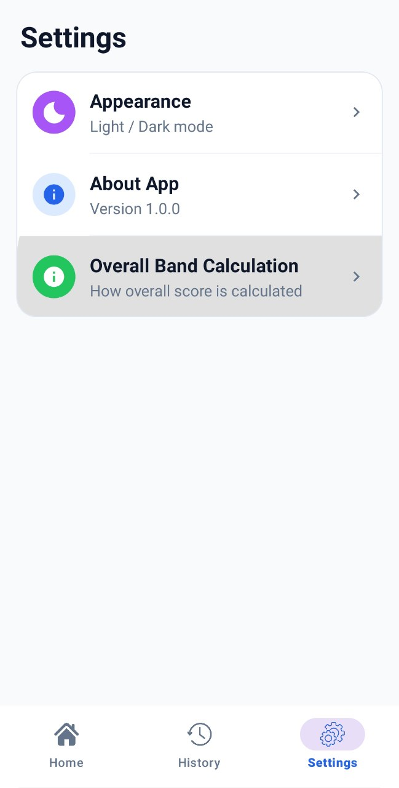
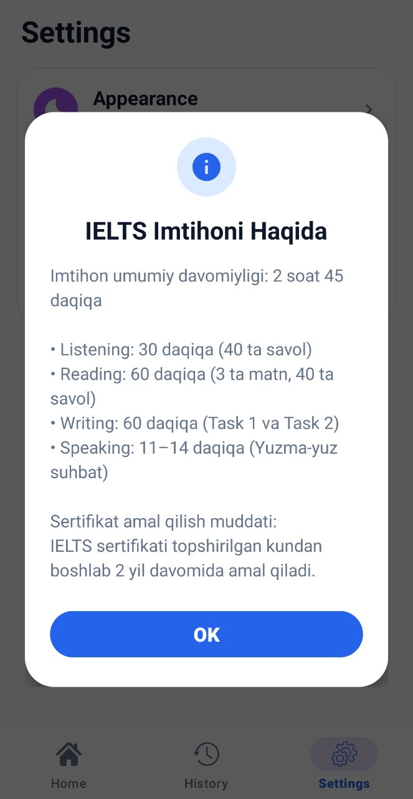
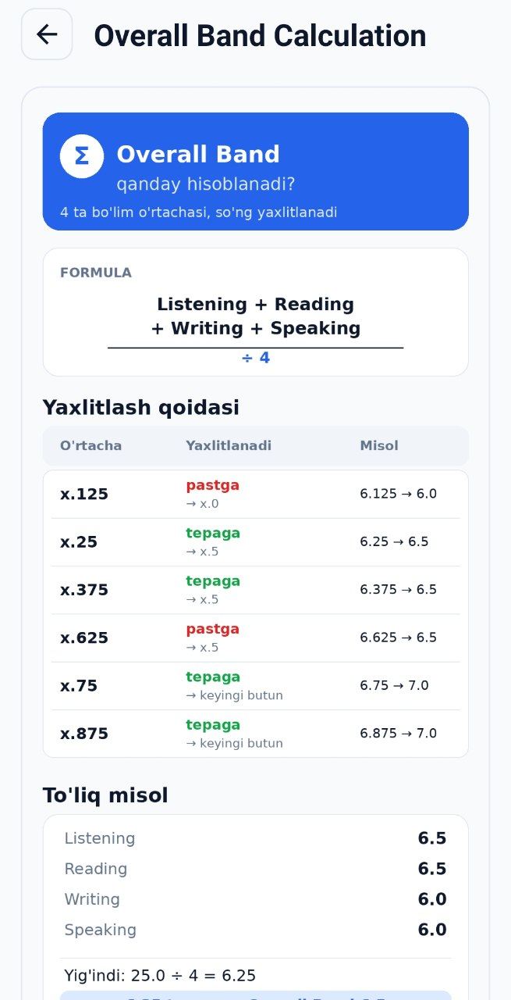

# IELTS MyBand

An IELTS band score tracker for Android.

> 🧪 Currently in testing on Google Play. The link will be added after release.

> 📚 **Note:** This is a simple project I built while learning Android app architecture (Clean Architecture, Hilt, Room).

## Screenshots

  
  
  
  

  
  
  

## Features
- Enter your Listening, Reading, Writing and Speaking scores
- Automatic overall band calculation
- History of saved scores
- Light and dark mode
- Works offline, all data is stored on your device

## Tech
- Language: Kotlin
- Architecture: Clean Architecture (data / domain / presentation)
- UI: XML layouts + ViewBinding, Navigation Component
- Local database: Room
- Dependency injection: Hilt
- Platform: Android (min SDK 24)

## Author
Asadbek
